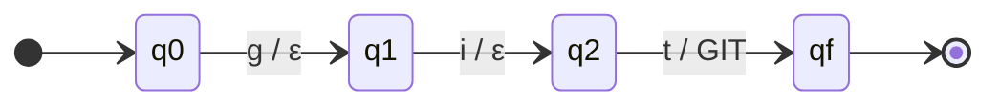
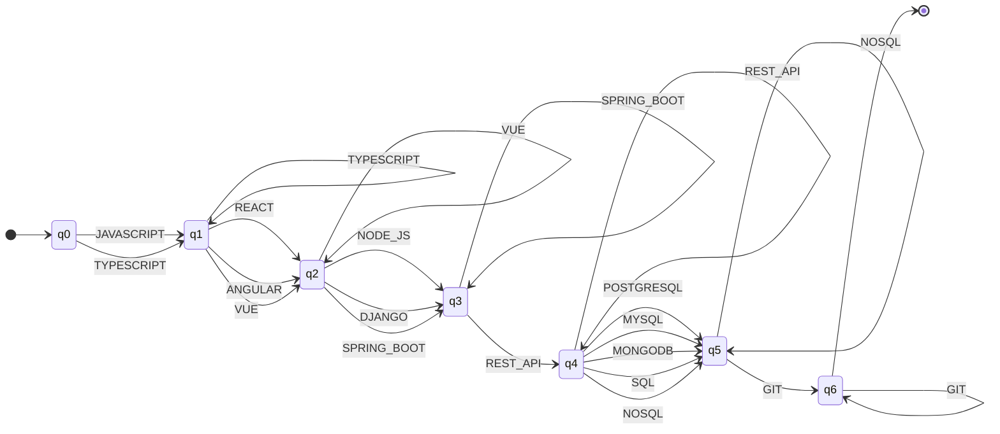
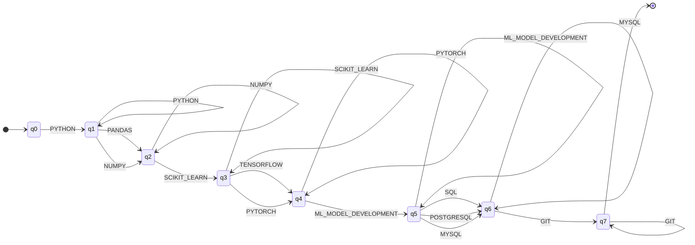
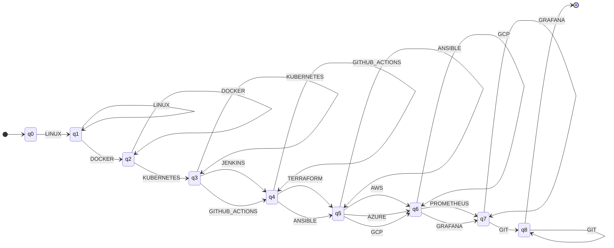
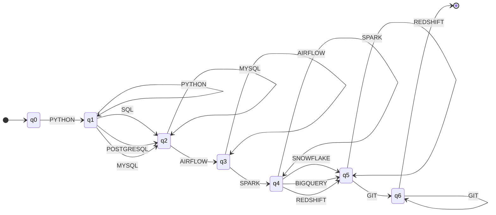

# Formalization

This document defines the formal object behind each stage of ResumeLens that uses a finite machine: the finite-state transducers of Stage 2 and the finite automata of Stage 3. The regular expressions of Stage 1 are explained in regex-patterns.md and the grammar of Stage 4 in its own document. The tuples below are generated from the same tables the code uses (`python -m src diagrams`), so they match the implementation.

## Finite-state transducer

Every transducer is a 7-tuple M = (Q, Sigma, Gamma, delta, omega, q0, F), where:

- Q is the finite set of states.
- Sigma is the input alphabet: the lowercase characters that appear in the known spellings of a qualification (letters, digits, dot, hyphen and space).
- Gamma is the output alphabet: the canonical tokens, such as JAVASCRIPT.
- delta is the transition relation, a set of triples (q, a, q') meaning that from state q reading character a the machine can move to q'. It is a relation and not a function because a short spelling can be the beginning of a longer one (`react` and `react.js`).
- omega is the output relation: it assigns to every transition the string it prints, which is epsilon (nothing) for every transition except the one that reads the last character of a spelling, which prints the canonical token.
- q0 is the initial state.
- F is the set of accepting states. Here F = {qf}, the state reached after reading a complete spelling.

A raw term is lowercased and read character by character. If the machine ends in qf, the output is the canonical token; otherwise the term is not recognized and it is returned unchanged and flagged.

There is one small transducer for each canonical token, and the transducer of a profile is the union of the ones for the tokens of that profile: all of them start in the same q0 and keep their own states. The same construction is used for the four profiles, only the set of tokens changes. The complete 7-tuple, the transition table and the diagram of every transducer are in stage2-transducers.md. As an example, this is the smallest one:

#### Transducer for GIT

- Q = {q0, q1, q2, qf}
- Sigma = {g, i, t}
- Gamma = {GIT}
- q0 = q0
- F = {qf}
- delta and omega (one row per transition, output is epsilon when nothing is printed):

| from | reads | to | prints |
|------|-------|----|--------|
| q0 | g | q1 | epsilon |
| q1 | i | q2 | epsilon |
| q2 | t | qf | GIT |

The longer ones follow the same idea. For instance, the transducer of JAVASCRIPT accepts `js`, `javascript` and `java script`, and the one of REACT accepts `react`, `react.js`, `reactjs` and `react js`.

### Canonical order

After normalization the tokens are sorted by the order of their profile (module canonical_order). This makes the sequence independent from the order in which the resume was written. For Full Stack Developer the order is Frontend, Backend, Database and Version control, as in the guide. Repeated tokens are removed and tokens that are not part of the profile are left out, so the sequence only contains symbols of the alphabet of that profile's automaton.

## Finite automata (Stage 3)

Every automaton is a 5-tuple M = (Q, Sigma, delta, q0, F), where Q is the finite set of states, Sigma is the alphabet (the canonical tokens of the profile), delta is the transition function, q0 is the initial state and F is the set of accepting states.

All four automata are **DFAs**: from every state there is at most one transition for each token, so the next state is always determined, and there are no epsilon transitions. delta is a partial function: a transition that is not defined means that the sequence is rejected. This holds because the categories of a profile never share tokens (checked by a test).

Each profile is a list of n categories (for example language, UI framework, backend, ...). State q_i means that the first i categories already have at least one qualification. Reading a token of category i moves q_i to q_(i+1); reading another token of the category that was just completed keeps the automaton in q_(i+1), so a resume that lists both Pandas and NumPy is not rejected because of it. The only accepting state is q_n. In short, a sequence is accepted when it covers every category of the profile, in the canonical order. The result is a yes or no answer: ResumeLens does not rank candidates.

### Automaton for FULL_STACK_DEVELOPER

Type: DFA (one transition at most per state and token, no epsilon transitions).

- Q = {q0, q1, q2, q3, q4, q5, q6}
- Sigma = {JAVASCRIPT, TYPESCRIPT, REACT, ANGULAR, VUE, NODE_JS, DJANGO, SPRING_BOOT, REST_API, POSTGRESQL, MYSQL, MONGODB, SQL, NOSQL, GIT}
- q0 = q0
- F = {q6}
- delta (partial function, a missing transition means reject):

| from | reads | to |
|------|-------|----|
| q0 | JAVASCRIPT | q1 |
| q1 | JAVASCRIPT | q1 |
| q0 | TYPESCRIPT | q1 |
| q1 | TYPESCRIPT | q1 |
| q1 | REACT | q2 |
| q2 | REACT | q2 |
| q1 | ANGULAR | q2 |
| q2 | ANGULAR | q2 |
| q1 | VUE | q2 |
| q2 | VUE | q2 |
| q2 | NODE_JS | q3 |
| q3 | NODE_JS | q3 |
| q2 | DJANGO | q3 |
| q3 | DJANGO | q3 |
| q2 | SPRING_BOOT | q3 |
| q3 | SPRING_BOOT | q3 |
| q3 | REST_API | q4 |
| q4 | REST_API | q4 |
| q4 | POSTGRESQL | q5 |
| q5 | POSTGRESQL | q5 |
| q4 | MYSQL | q5 |
| q5 | MYSQL | q5 |
| q4 | MONGODB | q5 |
| q5 | MONGODB | q5 |
| q4 | SQL | q5 |
| q5 | SQL | q5 |
| q4 | NOSQL | q5 |
| q5 | NOSQL | q5 |
| q5 | GIT | q6 |
| q6 | GIT | q6 |

Pattern, in order: language (JAVASCRIPT | TYPESCRIPT) -> ui framework (REACT | ANGULAR | VUE) -> backend technology (NODE_JS | DJANGO | SPRING_BOOT) -> api (REST_API) -> database (POSTGRESQL | MYSQL | MONGODB | SQL | NOSQL) -> version control (GIT)

### Automaton for MACHINE_LEARNING_ENGINEER

Type: DFA (one transition at most per state and token, no epsilon transitions).

- Q = {q0, q1, q2, q3, q4, q5, q6, q7}
- Sigma = {PYTHON, PANDAS, NUMPY, SCIKIT_LEARN, TENSORFLOW, PYTORCH, ML_MODEL_DEVELOPMENT, SQL, POSTGRESQL, MYSQL, GIT}
- q0 = q0
- F = {q7}
- delta (partial function, a missing transition means reject):

| from | reads | to |
|------|-------|----|
| q0 | PYTHON | q1 |
| q1 | PYTHON | q1 |
| q1 | PANDAS | q2 |
| q2 | PANDAS | q2 |
| q1 | NUMPY | q2 |
| q2 | NUMPY | q2 |
| q2 | SCIKIT_LEARN | q3 |
| q3 | SCIKIT_LEARN | q3 |
| q3 | TENSORFLOW | q4 |
| q4 | TENSORFLOW | q4 |
| q3 | PYTORCH | q4 |
| q4 | PYTORCH | q4 |
| q4 | ML_MODEL_DEVELOPMENT | q5 |
| q5 | ML_MODEL_DEVELOPMENT | q5 |
| q5 | SQL | q6 |
| q6 | SQL | q6 |
| q5 | POSTGRESQL | q6 |
| q6 | POSTGRESQL | q6 |
| q5 | MYSQL | q6 |
| q6 | MYSQL | q6 |
| q6 | GIT | q7 |
| q7 | GIT | q7 |

Pattern, in order: language (PYTHON) -> data library (PANDAS | NUMPY) -> classic ml library (SCIKIT_LEARN) -> deep learning library (TENSORFLOW | PYTORCH) -> model development (ML_MODEL_DEVELOPMENT) -> database (SQL | POSTGRESQL | MYSQL) -> version control (GIT)

### Automaton for DEVOPS_ENGINEER

Type: DFA (one transition at most per state and token, no epsilon transitions).

- Q = {q0, q1, q2, q3, q4, q5, q6, q7, q8}
- Sigma = {LINUX, DOCKER, KUBERNETES, JENKINS, GITHUB_ACTIONS, TERRAFORM, ANSIBLE, AWS, AZURE, GCP, PROMETHEUS, GRAFANA, GIT}
- q0 = q0
- F = {q8}
- delta (partial function, a missing transition means reject):

| from | reads | to |
|------|-------|----|
| q0 | LINUX | q1 |
| q1 | LINUX | q1 |
| q1 | DOCKER | q2 |
| q2 | DOCKER | q2 |
| q2 | KUBERNETES | q3 |
| q3 | KUBERNETES | q3 |
| q3 | JENKINS | q4 |
| q4 | JENKINS | q4 |
| q3 | GITHUB_ACTIONS | q4 |
| q4 | GITHUB_ACTIONS | q4 |
| q4 | TERRAFORM | q5 |
| q5 | TERRAFORM | q5 |
| q4 | ANSIBLE | q5 |
| q5 | ANSIBLE | q5 |
| q5 | AWS | q6 |
| q6 | AWS | q6 |
| q5 | AZURE | q6 |
| q6 | AZURE | q6 |
| q5 | GCP | q6 |
| q6 | GCP | q6 |
| q6 | PROMETHEUS | q7 |
| q7 | PROMETHEUS | q7 |
| q6 | GRAFANA | q7 |
| q7 | GRAFANA | q7 |
| q7 | GIT | q8 |
| q8 | GIT | q8 |

Pattern, in order: operating system (LINUX) -> container runtime (DOCKER) -> orchestration (KUBERNETES) -> ci/cd (JENKINS | GITHUB_ACTIONS) -> infrastructure as code (TERRAFORM | ANSIBLE) -> cloud provider (AWS | AZURE | GCP) -> monitoring (PROMETHEUS | GRAFANA) -> version control (GIT)

### Automaton for DATA_ENGINEER

Type: DFA (one transition at most per state and token, no epsilon transitions).

- Q = {q0, q1, q2, q3, q4, q5, q6}
- Sigma = {PYTHON, SQL, POSTGRESQL, MYSQL, AIRFLOW, SPARK, SNOWFLAKE, BIGQUERY, REDSHIFT, GIT}
- q0 = q0
- F = {q6}
- delta (partial function, a missing transition means reject):

| from | reads | to |
|------|-------|----|
| q0 | PYTHON | q1 |
| q1 | PYTHON | q1 |
| q1 | SQL | q2 |
| q2 | SQL | q2 |
| q1 | POSTGRESQL | q2 |
| q2 | POSTGRESQL | q2 |
| q1 | MYSQL | q2 |
| q2 | MYSQL | q2 |
| q2 | AIRFLOW | q3 |
| q3 | AIRFLOW | q3 |
| q3 | SPARK | q4 |
| q4 | SPARK | q4 |
| q4 | SNOWFLAKE | q5 |
| q5 | SNOWFLAKE | q5 |
| q4 | BIGQUERY | q5 |
| q5 | BIGQUERY | q5 |
| q4 | REDSHIFT | q5 |
| q5 | REDSHIFT | q5 |
| q5 | GIT | q6 |
| q6 | GIT | q6 |

Pattern, in order: language (PYTHON) -> database (SQL | POSTGRESQL | MYSQL) -> orchestration (AIRFLOW) -> distributed processing (SPARK) -> data warehouse (SNOWFLAKE | BIGQUERY | REDSHIFT) -> version control (GIT)

