# Stage 2 transducers (generated)

Generated by `python -m src diagrams`.

#### Transducer for JAVASCRIPT

- Q = {q0, q1, q2, q3, q4, q5, q6, q7, q8, q9, q10, q11, q12, q13, q14, q15, qf}
- Sigma = {space, a, c, i, j, p, r, s, t, v}
- Gamma = {JAVASCRIPT}
- q0 = q0
- F = {qf}
- Transitions and outputs, one row each (epsilon means nothing is printed):

| from | reads | to | prints |
|------|-------|----|--------|
| q0 | j | q1 | epsilon |
| q1 | s | qf | JAVASCRIPT |
| q1 | a | q2 | epsilon |
| q2 | v | q3 | epsilon |
| q3 | a | q4 | epsilon |
| q4 | s | q5 | epsilon |
| q5 | c | q6 | epsilon |
| q6 | r | q7 | epsilon |
| q7 | i | q8 | epsilon |
| q8 | p | q9 | epsilon |
| q9 | t | qf | JAVASCRIPT |
| q4 | space | q10 | epsilon |
| q10 | s | q11 | epsilon |
| q11 | c | q12 | epsilon |
| q12 | r | q13 | epsilon |
| q13 | i | q14 | epsilon |
| q14 | p | q15 | epsilon |
| q15 | t | qf | JAVASCRIPT |


#### Transducer for TYPESCRIPT

- Q = {q0, q1, q2, q3, q4, q5, q6, q7, q8, q9, q10, q11, q12, q13, q14, q15, qf}
- Sigma = {space, c, e, i, p, r, s, t, y}
- Gamma = {TYPESCRIPT}
- q0 = q0
- F = {qf}
- Transitions and outputs, one row each (epsilon means nothing is printed):

| from | reads | to | prints |
|------|-------|----|--------|
| q0 | t | q1 | epsilon |
| q1 | s | qf | TYPESCRIPT |
| q1 | y | q2 | epsilon |
| q2 | p | q3 | epsilon |
| q3 | e | q4 | epsilon |
| q4 | s | q5 | epsilon |
| q5 | c | q6 | epsilon |
| q6 | r | q7 | epsilon |
| q7 | i | q8 | epsilon |
| q8 | p | q9 | epsilon |
| q9 | t | qf | TYPESCRIPT |
| q4 | space | q10 | epsilon |
| q10 | s | q11 | epsilon |
| q11 | c | q12 | epsilon |
| q12 | r | q13 | epsilon |
| q13 | i | q14 | epsilon |
| q14 | p | q15 | epsilon |
| q15 | t | qf | TYPESCRIPT |

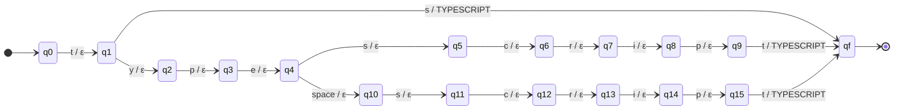

#### Transducer for REACT

- Q = {q0, q1, q2, q3, q4, q5, q6, q7, q8, q9, q10, qf}
- Sigma = {space, ., a, c, e, j, r, s, t}
- Gamma = {REACT}
- q0 = q0
- F = {qf}
- Transitions and outputs, one row each (epsilon means nothing is printed):

| from | reads | to | prints |
|------|-------|----|--------|
| q0 | r | q1 | epsilon |
| q1 | e | q2 | epsilon |
| q2 | a | q3 | epsilon |
| q3 | c | q4 | epsilon |
| q4 | t | qf | REACT |
| q4 | t | q5 | epsilon |
| q5 | . | q6 | epsilon |
| q6 | j | q7 | epsilon |
| q7 | s | qf | REACT |
| q5 | j | q8 | epsilon |
| q8 | s | qf | REACT |
| q5 | space | q9 | epsilon |
| q9 | j | q10 | epsilon |
| q10 | s | qf | REACT |

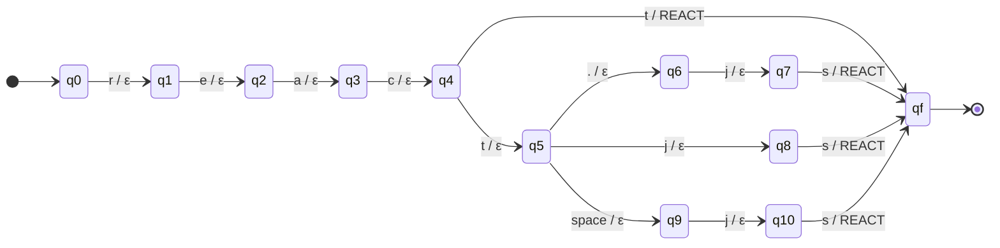

#### Transducer for ANGULAR

- Q = {q0, q1, q2, q3, q4, q5, q6, q7, q8, q9, q10, qf}
- Sigma = {., a, g, j, l, n, r, s, u}
- Gamma = {ANGULAR}
- q0 = q0
- F = {qf}
- Transitions and outputs, one row each (epsilon means nothing is printed):

| from | reads | to | prints |
|------|-------|----|--------|
| q0 | a | q1 | epsilon |
| q1 | n | q2 | epsilon |
| q2 | g | q3 | epsilon |
| q3 | u | q4 | epsilon |
| q4 | l | q5 | epsilon |
| q5 | a | q6 | epsilon |
| q6 | r | qf | ANGULAR |
| q6 | r | q7 | epsilon |
| q7 | . | q8 | epsilon |
| q8 | j | q9 | epsilon |
| q9 | s | qf | ANGULAR |
| q7 | j | q10 | epsilon |
| q10 | s | qf | ANGULAR |

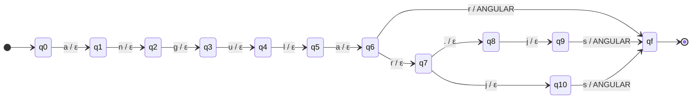

#### Transducer for VUE

- Q = {q0, q1, q2, q3, q4, q5, q6, qf}
- Sigma = {., e, j, s, u, v}
- Gamma = {VUE}
- q0 = q0
- F = {qf}
- Transitions and outputs, one row each (epsilon means nothing is printed):

| from | reads | to | prints |
|------|-------|----|--------|
| q0 | v | q1 | epsilon |
| q1 | u | q2 | epsilon |
| q2 | e | qf | VUE |
| q2 | e | q3 | epsilon |
| q3 | . | q4 | epsilon |
| q4 | j | q5 | epsilon |
| q5 | s | qf | VUE |
| q3 | j | q6 | epsilon |
| q6 | s | qf | VUE |

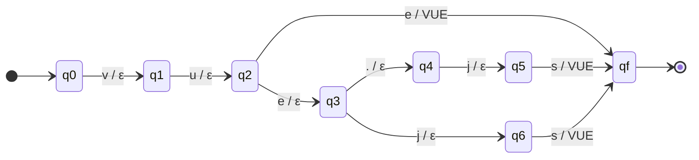

#### Transducer for NODE_JS

- Q = {q0, q1, q2, q3, q4, q5, q6, q7, q8, q9, qf}
- Sigma = {space, ., d, e, j, n, o, s}
- Gamma = {NODE_JS}
- q0 = q0
- F = {qf}
- Transitions and outputs, one row each (epsilon means nothing is printed):

| from | reads | to | prints |
|------|-------|----|--------|
| q0 | n | q1 | epsilon |
| q1 | o | q2 | epsilon |
| q2 | d | q3 | epsilon |
| q3 | e | q4 | epsilon |
| q4 | . | q5 | epsilon |
| q5 | j | q6 | epsilon |
| q6 | s | qf | NODE_JS |
| q4 | j | q7 | epsilon |
| q7 | s | qf | NODE_JS |
| q4 | space | q8 | epsilon |
| q8 | j | q9 | epsilon |
| q9 | s | qf | NODE_JS |

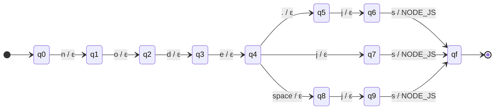

#### Transducer for DJANGO

- Q = {q0, q1, q2, q3, q4, q5, qf}
- Sigma = {a, d, g, j, n, o}
- Gamma = {DJANGO}
- q0 = q0
- F = {qf}
- Transitions and outputs, one row each (epsilon means nothing is printed):

| from | reads | to | prints |
|------|-------|----|--------|
| q0 | d | q1 | epsilon |
| q1 | j | q2 | epsilon |
| q2 | a | q3 | epsilon |
| q3 | n | q4 | epsilon |
| q4 | g | q5 | epsilon |
| q5 | o | qf | DJANGO |

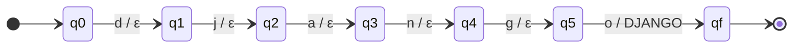

#### Transducer for SPRING_BOOT

- Q = {q0, q1, q2, q3, q4, q5, q6, q7, q8, q9, q10, q11, q12, q13, qf}
- Sigma = {space, b, g, i, n, o, p, r, s, t}
- Gamma = {SPRING_BOOT}
- q0 = q0
- F = {qf}
- Transitions and outputs, one row each (epsilon means nothing is printed):

| from | reads | to | prints |
|------|-------|----|--------|
| q0 | s | q1 | epsilon |
| q1 | p | q2 | epsilon |
| q2 | r | q3 | epsilon |
| q3 | i | q4 | epsilon |
| q4 | n | q5 | epsilon |
| q5 | g | q6 | epsilon |
| q6 | space | q7 | epsilon |
| q7 | b | q8 | epsilon |
| q8 | o | q9 | epsilon |
| q9 | o | q10 | epsilon |
| q10 | t | qf | SPRING_BOOT |
| q6 | b | q11 | epsilon |
| q11 | o | q12 | epsilon |
| q12 | o | q13 | epsilon |
| q13 | t | qf | SPRING_BOOT |

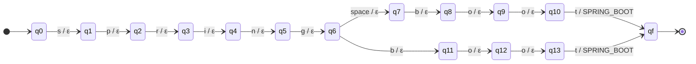

#### Transducer for REST_API

- Q = {q0, q1, q2, q3, q4, q5, q6, q7, q8, q9, q10, q11, q12, q13, q14, q15, qf}
- Sigma = {space, a, e, f, i, l, p, r, s, t, u}
- Gamma = {REST_API}
- q0 = q0
- F = {qf}
- Transitions and outputs, one row each (epsilon means nothing is printed):

| from | reads | to | prints |
|------|-------|----|--------|
| q0 | r | q1 | epsilon |
| q1 | e | q2 | epsilon |
| q2 | s | q3 | epsilon |
| q3 | t | q4 | epsilon |
| q4 | space | q5 | epsilon |
| q5 | a | q6 | epsilon |
| q6 | p | q7 | epsilon |
| q7 | i | qf | REST_API |
| q7 | i | q8 | epsilon |
| q8 | s | qf | REST_API |
| q4 | f | q9 | epsilon |
| q9 | u | q10 | epsilon |
| q10 | l | q11 | epsilon |
| q11 | space | q12 | epsilon |
| q12 | a | q13 | epsilon |
| q13 | p | q14 | epsilon |
| q14 | i | qf | REST_API |
| q14 | i | q15 | epsilon |
| q15 | s | qf | REST_API |

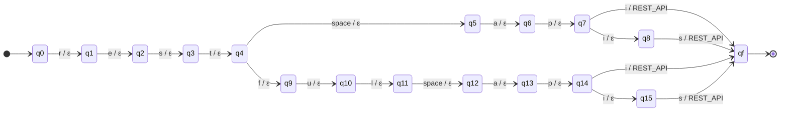

#### Transducer for POSTGRESQL

- Q = {q0, q1, q2, q3, q4, q5, q6, q7, q8, q9, q10, q11, q12, qf}
- Sigma = {space, e, g, l, o, p, q, r, s, t}
- Gamma = {POSTGRESQL}
- q0 = q0
- F = {qf}
- Transitions and outputs, one row each (epsilon means nothing is printed):

| from | reads | to | prints |
|------|-------|----|--------|
| q0 | p | q1 | epsilon |
| q1 | o | q2 | epsilon |
| q2 | s | q3 | epsilon |
| q3 | t | q4 | epsilon |
| q4 | g | q5 | epsilon |
| q5 | r | q6 | epsilon |
| q6 | e | q7 | epsilon |
| q7 | s | qf | POSTGRESQL |
| q7 | s | q8 | epsilon |
| q8 | q | q9 | epsilon |
| q9 | l | qf | POSTGRESQL |
| q7 | space | q10 | epsilon |
| q10 | s | q11 | epsilon |
| q11 | q | q12 | epsilon |
| q12 | l | qf | POSTGRESQL |

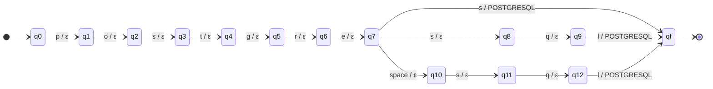

#### Transducer for MYSQL

- Q = {q0, q1, q2, q3, q4, q5, q6, q7, qf}
- Sigma = {space, l, m, q, s, y}
- Gamma = {MYSQL}
- q0 = q0
- F = {qf}
- Transitions and outputs, one row each (epsilon means nothing is printed):

| from | reads | to | prints |
|------|-------|----|--------|
| q0 | m | q1 | epsilon |
| q1 | y | q2 | epsilon |
| q2 | s | q3 | epsilon |
| q3 | q | q4 | epsilon |
| q4 | l | qf | MYSQL |
| q2 | space | q5 | epsilon |
| q5 | s | q6 | epsilon |
| q6 | q | q7 | epsilon |
| q7 | l | qf | MYSQL |

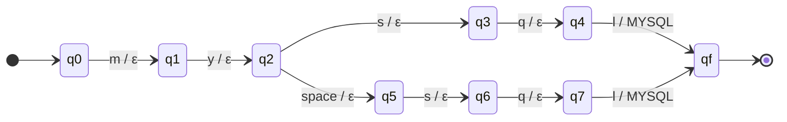

#### Transducer for MONGODB

- Q = {q0, q1, q2, q3, q4, q5, q6, q7, q8, qf}
- Sigma = {space, b, d, g, m, n, o}
- Gamma = {MONGODB}
- q0 = q0
- F = {qf}
- Transitions and outputs, one row each (epsilon means nothing is printed):

| from | reads | to | prints |
|------|-------|----|--------|
| q0 | m | q1 | epsilon |
| q1 | o | q2 | epsilon |
| q2 | n | q3 | epsilon |
| q3 | g | q4 | epsilon |
| q4 | o | q5 | epsilon |
| q5 | d | q6 | epsilon |
| q6 | b | qf | MONGODB |
| q5 | space | q7 | epsilon |
| q7 | d | q8 | epsilon |
| q8 | b | qf | MONGODB |

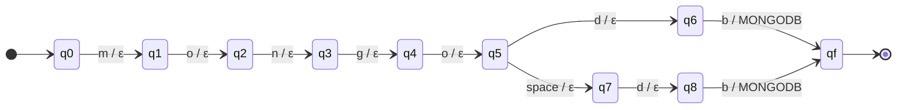

#### Transducer for SQL

- Q = {q0, q1, q2, qf}
- Sigma = {l, q, s}
- Gamma = {SQL}
- q0 = q0
- F = {qf}
- Transitions and outputs, one row each (epsilon means nothing is printed):

| from | reads | to | prints |
|------|-------|----|--------|
| q0 | s | q1 | epsilon |
| q1 | q | q2 | epsilon |
| q2 | l | qf | SQL |

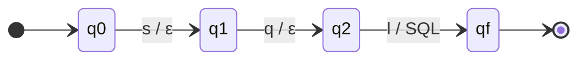

#### Transducer for NOSQL

- Q = {q0, q1, q2, q3, q4, q5, q6, q7, qf}
- Sigma = {space, l, n, o, q, s}
- Gamma = {NOSQL}
- q0 = q0
- F = {qf}
- Transitions and outputs, one row each (epsilon means nothing is printed):

| from | reads | to | prints |
|------|-------|----|--------|
| q0 | n | q1 | epsilon |
| q1 | o | q2 | epsilon |
| q2 | s | q3 | epsilon |
| q3 | q | q4 | epsilon |
| q4 | l | qf | NOSQL |
| q2 | space | q5 | epsilon |
| q5 | s | q6 | epsilon |
| q6 | q | q7 | epsilon |
| q7 | l | qf | NOSQL |

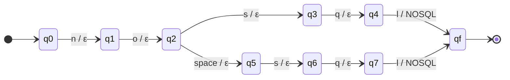

#### Transducer for GIT

- Q = {q0, q1, q2, qf}
- Sigma = {g, i, t}
- Gamma = {GIT}
- q0 = q0
- F = {qf}
- Transitions and outputs, one row each (epsilon means nothing is printed):

| from | reads | to | prints |
|------|-------|----|--------|
| q0 | g | q1 | epsilon |
| q1 | i | q2 | epsilon |
| q2 | t | qf | GIT |

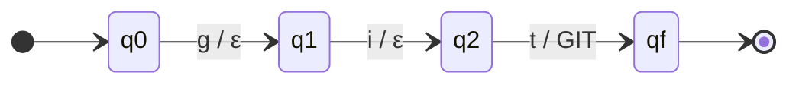

#### Transducer for PYTHON

- Q = {q0, q1, q2, q3, q4, q5, qf}
- Sigma = {h, n, o, p, t, y}
- Gamma = {PYTHON}
- q0 = q0
- F = {qf}
- Transitions and outputs, one row each (epsilon means nothing is printed):

| from | reads | to | prints |
|------|-------|----|--------|
| q0 | p | q1 | epsilon |
| q1 | y | q2 | epsilon |
| q2 | t | q3 | epsilon |
| q3 | h | q4 | epsilon |
| q4 | o | q5 | epsilon |
| q5 | n | qf | PYTHON |

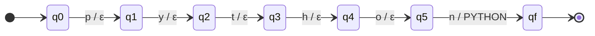

#### Transducer for PANDAS

- Q = {q0, q1, q2, q3, q4, q5, qf}
- Sigma = {a, d, n, p, s}
- Gamma = {PANDAS}
- q0 = q0
- F = {qf}
- Transitions and outputs, one row each (epsilon means nothing is printed):

| from | reads | to | prints |
|------|-------|----|--------|
| q0 | p | q1 | epsilon |
| q1 | a | q2 | epsilon |
| q2 | n | q3 | epsilon |
| q3 | d | q4 | epsilon |
| q4 | a | q5 | epsilon |
| q5 | s | qf | PANDAS |

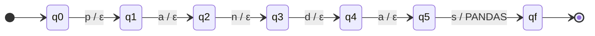

#### Transducer for NUMPY

- Q = {q0, q1, q2, q3, q4, q5, q6, qf}
- Sigma = {space, m, n, p, u, y}
- Gamma = {NUMPY}
- q0 = q0
- F = {qf}
- Transitions and outputs, one row each (epsilon means nothing is printed):

| from | reads | to | prints |
|------|-------|----|--------|
| q0 | n | q1 | epsilon |
| q1 | u | q2 | epsilon |
| q2 | m | q3 | epsilon |
| q3 | p | q4 | epsilon |
| q4 | y | qf | NUMPY |
| q3 | space | q5 | epsilon |
| q5 | p | q6 | epsilon |
| q6 | y | qf | NUMPY |

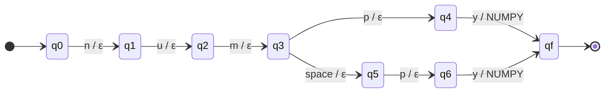

#### Transducer for SCIKIT_LEARN

- Q = {q0, q1, q2, q3, q4, q5, q6, q7, q8, q9, q10, q11, q12, q13, q14, q15, q16, q17, q18, q19, q20, q21, q22, q23, q24, q25, qf}
- Sigma = {space, -, a, c, e, i, k, l, n, r, s, t}
- Gamma = {SCIKIT_LEARN}
- q0 = q0
- F = {qf}
- Transitions and outputs, one row each (epsilon means nothing is printed):

| from | reads | to | prints |
|------|-------|----|--------|
| q0 | s | q1 | epsilon |
| q1 | c | q2 | epsilon |
| q2 | i | q3 | epsilon |
| q3 | k | q4 | epsilon |
| q4 | i | q5 | epsilon |
| q5 | t | q6 | epsilon |
| q6 | - | q7 | epsilon |
| q7 | l | q8 | epsilon |
| q8 | e | q9 | epsilon |
| q9 | a | q10 | epsilon |
| q10 | r | q11 | epsilon |
| q11 | n | qf | SCIKIT_LEARN |
| q6 | space | q12 | epsilon |
| q12 | l | q13 | epsilon |
| q13 | e | q14 | epsilon |
| q14 | a | q15 | epsilon |
| q15 | r | q16 | epsilon |
| q16 | n | qf | SCIKIT_LEARN |
| q6 | l | q17 | epsilon |
| q17 | e | q18 | epsilon |
| q18 | a | q19 | epsilon |
| q19 | r | q20 | epsilon |
| q20 | n | qf | SCIKIT_LEARN |
| q1 | k | q21 | epsilon |
| q21 | l | q22 | epsilon |
| q22 | e | q23 | epsilon |
| q23 | a | q24 | epsilon |
| q24 | r | q25 | epsilon |
| q25 | n | qf | SCIKIT_LEARN |

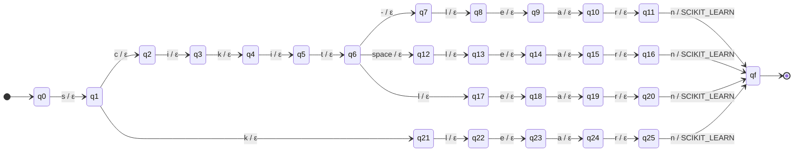

#### Transducer for TENSORFLOW

- Q = {q0, q1, q2, q3, q4, q5, q6, q7, q8, q9, q10, q11, q12, q13, qf}
- Sigma = {space, e, f, l, n, o, r, s, t, w}
- Gamma = {TENSORFLOW}
- q0 = q0
- F = {qf}
- Transitions and outputs, one row each (epsilon means nothing is printed):

| from | reads | to | prints |
|------|-------|----|--------|
| q0 | t | q1 | epsilon |
| q1 | e | q2 | epsilon |
| q2 | n | q3 | epsilon |
| q3 | s | q4 | epsilon |
| q4 | o | q5 | epsilon |
| q5 | r | q6 | epsilon |
| q6 | f | q7 | epsilon |
| q7 | l | q8 | epsilon |
| q8 | o | q9 | epsilon |
| q9 | w | qf | TENSORFLOW |
| q6 | space | q10 | epsilon |
| q10 | f | q11 | epsilon |
| q11 | l | q12 | epsilon |
| q12 | o | q13 | epsilon |
| q13 | w | qf | TENSORFLOW |

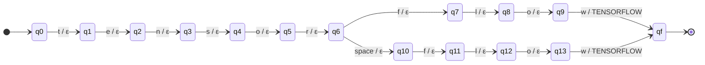

#### Transducer for PYTORCH

- Q = {q0, q1, q2, q3, q4, q5, q6, q7, q8, q9, q10, q11, qf}
- Sigma = {space, c, h, o, p, r, t, y}
- Gamma = {PYTORCH}
- q0 = q0
- F = {qf}
- Transitions and outputs, one row each (epsilon means nothing is printed):

| from | reads | to | prints |
|------|-------|----|--------|
| q0 | p | q1 | epsilon |
| q1 | y | q2 | epsilon |
| q2 | t | q3 | epsilon |
| q3 | o | q4 | epsilon |
| q4 | r | q5 | epsilon |
| q5 | c | q6 | epsilon |
| q6 | h | qf | PYTORCH |
| q2 | space | q7 | epsilon |
| q7 | t | q8 | epsilon |
| q8 | o | q9 | epsilon |
| q9 | r | q10 | epsilon |
| q10 | c | q11 | epsilon |
| q11 | h | qf | PYTORCH |

```mermaid
stateDiagram-v2
    direction LR
    [*] --> q0
    q0 --> q1: p / ε
    q1 --> q2: y / ε
    q2 --> q3: t / ε
    q3 --> q4: o / ε
    q4 --> q5: r / ε
    q5 --> q6: c / ε
    q6 --> qf: h / PYTORCH
    q2 --> q7: space / ε
    q7 --> q8: t / ε
    q8 --> q9: o / ε
    q9 --> q10: r / ε
    q10 --> q11: c / ε
    q11 --> qf: h / PYTORCH
    qf --> [*]
```

#### Transducer for ML_MODEL_DEVELOPMENT

- Q = {q0, q1, q2, q3, q4, q5, q6, q7, q8, q9, q10, q11, q12, q13, q14, q15, q16, q17, q18, q19, q20, q21, q22, q23, q24, q25, q26, q27, q28, q29, q30, q31, q32, q33, q34, q35, q36, q37, q38, q39, q40, q41, q42, q43, q44, q45, q46, q47, q48, q49, q50, q51, q52, q53, q54, q55, q56, q57, q58, q59, q60, q61, q62, q63, q64, q65, q66, q67, q68, q69, q70, q71, q72, q73, q74, q75, q76, q77, q78, q79, q80, q81, q82, q83, q84, q85, q86, q87, q88, q89, q90, q91, q92, qf}
- Sigma = {space, -, a, c, d, e, g, h, i, l, m, n, o, p, r, t, v}
- Gamma = {ML_MODEL_DEVELOPMENT}
- q0 = q0
- F = {qf}
- Transitions and outputs, one row each (epsilon means nothing is printed):

| from | reads | to | prints |
|------|-------|----|--------|
| q0 | m | q1 | epsilon |
| q1 | a | q2 | epsilon |
| q2 | c | q3 | epsilon |
| q3 | h | q4 | epsilon |
| q4 | i | q5 | epsilon |
| q5 | n | q6 | epsilon |
| q6 | e | q7 | epsilon |
| q7 | - | q8 | epsilon |
| q8 | l | q9 | epsilon |
| q9 | e | q10 | epsilon |
| q10 | a | q11 | epsilon |
| q11 | r | q12 | epsilon |
| q12 | n | q13 | epsilon |
| q13 | i | q14 | epsilon |
| q14 | n | q15 | epsilon |
| q15 | g | q16 | epsilon |
| q16 | space | q17 | epsilon |
| q17 | m | q18 | epsilon |
| q18 | o | q19 | epsilon |
| q19 | d | q20 | epsilon |
| q20 | e | q21 | epsilon |
| q21 | l | q22 | epsilon |
| q22 | space | q23 | epsilon |
| q23 | d | q24 | epsilon |
| q24 | e | q25 | epsilon |
| q25 | v | q26 | epsilon |
| q26 | e | q27 | epsilon |
| q27 | l | q28 | epsilon |
| q28 | o | q29 | epsilon |
| q29 | p | q30 | epsilon |
| q30 | m | q31 | epsilon |
| q31 | e | q32 | epsilon |
| q32 | n | q33 | epsilon |
| q33 | t | qf | ML_MODEL_DEVELOPMENT |
| q7 | space | q34 | epsilon |
| q34 | l | q35 | epsilon |
| q35 | e | q36 | epsilon |
| q36 | a | q37 | epsilon |
| q37 | r | q38 | epsilon |
| q38 | n | q39 | epsilon |
| q39 | i | q40 | epsilon |
| q40 | n | q41 | epsilon |
| q41 | g | q42 | epsilon |
| q42 | space | q43 | epsilon |
| q43 | m | q44 | epsilon |
| q44 | o | q45 | epsilon |
| q45 | d | q46 | epsilon |
| q46 | e | q47 | epsilon |
| q47 | l | q48 | epsilon |
| q48 | space | q49 | epsilon |
| q49 | d | q50 | epsilon |
| q50 | e | q51 | epsilon |
| q51 | v | q52 | epsilon |
| q52 | e | q53 | epsilon |
| q53 | l | q54 | epsilon |
| q54 | o | q55 | epsilon |
| q55 | p | q56 | epsilon |
| q56 | m | q57 | epsilon |
| q57 | e | q58 | epsilon |
| q58 | n | q59 | epsilon |
| q59 | t | qf | ML_MODEL_DEVELOPMENT |
| q1 | l | q60 | epsilon |
| q60 | space | q61 | epsilon |
| q61 | m | q62 | epsilon |
| q62 | o | q63 | epsilon |
| q63 | d | q64 | epsilon |
| q64 | e | q65 | epsilon |
| q65 | l | q66 | epsilon |
| q66 | space | q67 | epsilon |
| q67 | d | q68 | epsilon |
| q68 | e | q69 | epsilon |
| q69 | v | q70 | epsilon |
| q70 | e | q71 | epsilon |
| q71 | l | q72 | epsilon |
| q72 | o | q73 | epsilon |
| q73 | p | q74 | epsilon |
| q74 | m | q75 | epsilon |
| q75 | e | q76 | epsilon |
| q76 | n | q77 | epsilon |
| q77 | t | qf | ML_MODEL_DEVELOPMENT |
| q1 | o | q78 | epsilon |
| q78 | d | q79 | epsilon |
| q79 | e | q80 | epsilon |
| q80 | l | q81 | epsilon |
| q81 | space | q82 | epsilon |
| q82 | d | q83 | epsilon |
| q83 | e | q84 | epsilon |
| q84 | v | q85 | epsilon |
| q85 | e | q86 | epsilon |
| q86 | l | q87 | epsilon |
| q87 | o | q88 | epsilon |
| q88 | p | q89 | epsilon |
| q89 | m | q90 | epsilon |
| q90 | e | q91 | epsilon |
| q91 | n | q92 | epsilon |
| q92 | t | qf | ML_MODEL_DEVELOPMENT |

```mermaid
stateDiagram-v2
    direction LR
    [*] --> q0
    q0 --> q1: m / ε
    q1 --> q2: a / ε
    q2 --> q3: c / ε
    q3 --> q4: h / ε
    q4 --> q5: i / ε
    q5 --> q6: n / ε
    q6 --> q7: e / ε
    q7 --> q8: - / ε
    q8 --> q9: l / ε
    q9 --> q10: e / ε
    q10 --> q11: a / ε
    q11 --> q12: r / ε
    q12 --> q13: n / ε
    q13 --> q14: i / ε
    q14 --> q15: n / ε
    q15 --> q16: g / ε
    q16 --> q17: space / ε
    q17 --> q18: m / ε
    q18 --> q19: o / ε
    q19 --> q20: d / ε
    q20 --> q21: e / ε
    q21 --> q22: l / ε
    q22 --> q23: space / ε
    q23 --> q24: d / ε
    q24 --> q25: e / ε
    q25 --> q26: v / ε
    q26 --> q27: e / ε
    q27 --> q28: l / ε
    q28 --> q29: o / ε
    q29 --> q30: p / ε
    q30 --> q31: m / ε
    q31 --> q32: e / ε
    q32 --> q33: n / ε
    q33 --> qf: t / ML_MODEL_DEVELOPMENT
    q7 --> q34: space / ε
    q34 --> q35: l / ε
    q35 --> q36: e / ε
    q36 --> q37: a / ε
    q37 --> q38: r / ε
    q38 --> q39: n / ε
    q39 --> q40: i / ε
    q40 --> q41: n / ε
    q41 --> q42: g / ε
    q42 --> q43: space / ε
    q43 --> q44: m / ε
    q44 --> q45: o / ε
    q45 --> q46: d / ε
    q46 --> q47: e / ε
    q47 --> q48: l / ε
    q48 --> q49: space / ε
    q49 --> q50: d / ε
    q50 --> q51: e / ε
    q51 --> q52: v / ε
    q52 --> q53: e / ε
    q53 --> q54: l / ε
    q54 --> q55: o / ε
    q55 --> q56: p / ε
    q56 --> q57: m / ε
    q57 --> q58: e / ε
    q58 --> q59: n / ε
    q59 --> qf: t / ML_MODEL_DEVELOPMENT
    q1 --> q60: l / ε
    q60 --> q61: space / ε
    q61 --> q62: m / ε
    q62 --> q63: o / ε
    q63 --> q64: d / ε
    q64 --> q65: e / ε
    q65 --> q66: l / ε
    q66 --> q67: space / ε
    q67 --> q68: d / ε
    q68 --> q69: e / ε
    q69 --> q70: v / ε
    q70 --> q71: e / ε
    q71 --> q72: l / ε
    q72 --> q73: o / ε
    q73 --> q74: p / ε
    q74 --> q75: m / ε
    q75 --> q76: e / ε
    q76 --> q77: n / ε
    q77 --> qf: t / ML_MODEL_DEVELOPMENT
    q1 --> q78: o / ε
    q78 --> q79: d / ε
    q79 --> q80: e / ε
    q80 --> q81: l / ε
    q81 --> q82: space / ε
    q82 --> q83: d / ε
    q83 --> q84: e / ε
    q84 --> q85: v / ε
    q85 --> q86: e / ε
    q86 --> q87: l / ε
    q87 --> q88: o / ε
    q88 --> q89: p / ε
    q89 --> q90: m / ε
    q90 --> q91: e / ε
    q91 --> q92: n / ε
    q92 --> qf: t / ML_MODEL_DEVELOPMENT
    qf --> [*]
```

#### Transducer for LINUX

- Q = {q0, q1, q2, q3, q4, qf}
- Sigma = {i, l, n, u, x}
- Gamma = {LINUX}
- q0 = q0
- F = {qf}
- Transitions and outputs, one row each (epsilon means nothing is printed):

| from | reads | to | prints |
|------|-------|----|--------|
| q0 | l | q1 | epsilon |
| q1 | i | q2 | epsilon |
| q2 | n | q3 | epsilon |
| q3 | u | q4 | epsilon |
| q4 | x | qf | LINUX |

```mermaid
stateDiagram-v2
    direction LR
    [*] --> q0
    q0 --> q1: l / ε
    q1 --> q2: i / ε
    q2 --> q3: n / ε
    q3 --> q4: u / ε
    q4 --> qf: x / LINUX
    qf --> [*]
```

#### Transducer for DOCKER

- Q = {q0, q1, q2, q3, q4, q5, qf}
- Sigma = {c, d, e, k, o, r}
- Gamma = {DOCKER}
- q0 = q0
- F = {qf}
- Transitions and outputs, one row each (epsilon means nothing is printed):

| from | reads | to | prints |
|------|-------|----|--------|
| q0 | d | q1 | epsilon |
| q1 | o | q2 | epsilon |
| q2 | c | q3 | epsilon |
| q3 | k | q4 | epsilon |
| q4 | e | q5 | epsilon |
| q5 | r | qf | DOCKER |

```mermaid
stateDiagram-v2
    direction LR
    [*] --> q0
    q0 --> q1: d / ε
    q1 --> q2: o / ε
    q2 --> q3: c / ε
    q3 --> q4: k / ε
    q4 --> q5: e / ε
    q5 --> qf: r / DOCKER
    qf --> [*]
```

#### Transducer for KUBERNETES

- Q = {q0, q1, q2, q3, q4, q5, q6, q7, q8, q9, q10, qf}
- Sigma = {8, b, e, k, n, r, s, t, u}
- Gamma = {KUBERNETES}
- q0 = q0
- F = {qf}
- Transitions and outputs, one row each (epsilon means nothing is printed):

| from | reads | to | prints |
|------|-------|----|--------|
| q0 | k | q1 | epsilon |
| q1 | u | q2 | epsilon |
| q2 | b | q3 | epsilon |
| q3 | e | q4 | epsilon |
| q4 | r | q5 | epsilon |
| q5 | n | q6 | epsilon |
| q6 | e | q7 | epsilon |
| q7 | t | q8 | epsilon |
| q8 | e | q9 | epsilon |
| q9 | s | qf | KUBERNETES |
| q1 | 8 | q10 | epsilon |
| q10 | s | qf | KUBERNETES |

```mermaid
stateDiagram-v2
    direction LR
    [*] --> q0
    q0 --> q1: k / ε
    q1 --> q2: u / ε
    q2 --> q3: b / ε
    q3 --> q4: e / ε
    q4 --> q5: r / ε
    q5 --> q6: n / ε
    q6 --> q7: e / ε
    q7 --> q8: t / ε
    q8 --> q9: e / ε
    q9 --> qf: s / KUBERNETES
    q1 --> q10: 8 / ε
    q10 --> qf: s / KUBERNETES
    qf --> [*]
```

#### Transducer for JENKINS

- Q = {q0, q1, q2, q3, q4, q5, q6, qf}
- Sigma = {e, i, j, k, n, s}
- Gamma = {JENKINS}
- q0 = q0
- F = {qf}
- Transitions and outputs, one row each (epsilon means nothing is printed):

| from | reads | to | prints |
|------|-------|----|--------|
| q0 | j | q1 | epsilon |
| q1 | e | q2 | epsilon |
| q2 | n | q3 | epsilon |
| q3 | k | q4 | epsilon |
| q4 | i | q5 | epsilon |
| q5 | n | q6 | epsilon |
| q6 | s | qf | JENKINS |

```mermaid
stateDiagram-v2
    direction LR
    [*] --> q0
    q0 --> q1: j / ε
    q1 --> q2: e / ε
    q2 --> q3: n / ε
    q3 --> q4: k / ε
    q4 --> q5: i / ε
    q5 --> q6: n / ε
    q6 --> qf: s / JENKINS
    qf --> [*]
```

#### Transducer for GITHUB_ACTIONS

- Q = {q0, q1, q2, q3, q4, q5, q6, q7, q8, q9, q10, q11, q12, q13, q14, q15, q16, q17, q18, q19, qf}
- Sigma = {space, a, b, c, g, h, i, n, o, s, t, u}
- Gamma = {GITHUB_ACTIONS}
- q0 = q0
- F = {qf}
- Transitions and outputs, one row each (epsilon means nothing is printed):

| from | reads | to | prints |
|------|-------|----|--------|
| q0 | g | q1 | epsilon |
| q1 | i | q2 | epsilon |
| q2 | t | q3 | epsilon |
| q3 | h | q4 | epsilon |
| q4 | u | q5 | epsilon |
| q5 | b | q6 | epsilon |
| q6 | space | q7 | epsilon |
| q7 | a | q8 | epsilon |
| q8 | c | q9 | epsilon |
| q9 | t | q10 | epsilon |
| q10 | i | q11 | epsilon |
| q11 | o | q12 | epsilon |
| q12 | n | q13 | epsilon |
| q13 | s | qf | GITHUB_ACTIONS |
| q6 | a | q14 | epsilon |
| q14 | c | q15 | epsilon |
| q15 | t | q16 | epsilon |
| q16 | i | q17 | epsilon |
| q17 | o | q18 | epsilon |
| q18 | n | q19 | epsilon |
| q19 | s | qf | GITHUB_ACTIONS |

```mermaid
stateDiagram-v2
    direction LR
    [*] --> q0
    q0 --> q1: g / ε
    q1 --> q2: i / ε
    q2 --> q3: t / ε
    q3 --> q4: h / ε
    q4 --> q5: u / ε
    q5 --> q6: b / ε
    q6 --> q7: space / ε
    q7 --> q8: a / ε
    q8 --> q9: c / ε
    q9 --> q10: t / ε
    q10 --> q11: i / ε
    q11 --> q12: o / ε
    q12 --> q13: n / ε
    q13 --> qf: s / GITHUB_ACTIONS
    q6 --> q14: a / ε
    q14 --> q15: c / ε
    q15 --> q16: t / ε
    q16 --> q17: i / ε
    q17 --> q18: o / ε
    q18 --> q19: n / ε
    q19 --> qf: s / GITHUB_ACTIONS
    qf --> [*]
```

#### Transducer for TERRAFORM

- Q = {q0, q1, q2, q3, q4, q5, q6, q7, q8, qf}
- Sigma = {a, e, f, m, o, r, t}
- Gamma = {TERRAFORM}
- q0 = q0
- F = {qf}
- Transitions and outputs, one row each (epsilon means nothing is printed):

| from | reads | to | prints |
|------|-------|----|--------|
| q0 | t | q1 | epsilon |
| q1 | e | q2 | epsilon |
| q2 | r | q3 | epsilon |
| q3 | r | q4 | epsilon |
| q4 | a | q5 | epsilon |
| q5 | f | q6 | epsilon |
| q6 | o | q7 | epsilon |
| q7 | r | q8 | epsilon |
| q8 | m | qf | TERRAFORM |

```mermaid
stateDiagram-v2
    direction LR
    [*] --> q0
    q0 --> q1: t / ε
    q1 --> q2: e / ε
    q2 --> q3: r / ε
    q3 --> q4: r / ε
    q4 --> q5: a / ε
    q5 --> q6: f / ε
    q6 --> q7: o / ε
    q7 --> q8: r / ε
    q8 --> qf: m / TERRAFORM
    qf --> [*]
```

#### Transducer for ANSIBLE

- Q = {q0, q1, q2, q3, q4, q5, q6, qf}
- Sigma = {a, b, e, i, l, n, s}
- Gamma = {ANSIBLE}
- q0 = q0
- F = {qf}
- Transitions and outputs, one row each (epsilon means nothing is printed):

| from | reads | to | prints |
|------|-------|----|--------|
| q0 | a | q1 | epsilon |
| q1 | n | q2 | epsilon |
| q2 | s | q3 | epsilon |
| q3 | i | q4 | epsilon |
| q4 | b | q5 | epsilon |
| q5 | l | q6 | epsilon |
| q6 | e | qf | ANSIBLE |

```mermaid
stateDiagram-v2
    direction LR
    [*] --> q0
    q0 --> q1: a / ε
    q1 --> q2: n / ε
    q2 --> q3: s / ε
    q3 --> q4: i / ε
    q4 --> q5: b / ε
    q5 --> q6: l / ε
    q6 --> qf: e / ANSIBLE
    qf --> [*]
```

#### Transducer for AWS

- Q = {q0, q1, q2, q3, q4, q5, q6, q7, q8, q9, q10, q11, q12, q13, q14, q15, q16, q17, q18, q19, qf}
- Sigma = {space, a, b, c, e, i, m, n, o, r, s, v, w, z}
- Gamma = {AWS}
- q0 = q0
- F = {qf}
- Transitions and outputs, one row each (epsilon means nothing is printed):

| from | reads | to | prints |
|------|-------|----|--------|
| q0 | a | q1 | epsilon |
| q1 | w | q2 | epsilon |
| q2 | s | qf | AWS |
| q1 | m | q3 | epsilon |
| q3 | a | q4 | epsilon |
| q4 | z | q5 | epsilon |
| q5 | o | q6 | epsilon |
| q6 | n | q7 | epsilon |
| q7 | space | q8 | epsilon |
| q8 | w | q9 | epsilon |
| q9 | e | q10 | epsilon |
| q10 | b | q11 | epsilon |
| q11 | space | q12 | epsilon |
| q12 | s | q13 | epsilon |
| q13 | e | q14 | epsilon |
| q14 | r | q15 | epsilon |
| q15 | v | q16 | epsilon |
| q16 | i | q17 | epsilon |
| q17 | c | q18 | epsilon |
| q18 | e | q19 | epsilon |
| q19 | s | qf | AWS |

```mermaid
stateDiagram-v2
    direction LR
    [*] --> q0
    q0 --> q1: a / ε
    q1 --> q2: w / ε
    q2 --> qf: s / AWS
    q1 --> q3: m / ε
    q3 --> q4: a / ε
    q4 --> q5: z / ε
    q5 --> q6: o / ε
    q6 --> q7: n / ε
    q7 --> q8: space / ε
    q8 --> q9: w / ε
    q9 --> q10: e / ε
    q10 --> q11: b / ε
    q11 --> q12: space / ε
    q12 --> q13: s / ε
    q13 --> q14: e / ε
    q14 --> q15: r / ε
    q15 --> q16: v / ε
    q16 --> q17: i / ε
    q17 --> q18: c / ε
    q18 --> q19: e / ε
    q19 --> qf: s / AWS
    qf --> [*]
```

#### Transducer for AZURE

- Q = {q0, q1, q2, q3, q4, qf}
- Sigma = {a, e, r, u, z}
- Gamma = {AZURE}
- q0 = q0
- F = {qf}
- Transitions and outputs, one row each (epsilon means nothing is printed):

| from | reads | to | prints |
|------|-------|----|--------|
| q0 | a | q1 | epsilon |
| q1 | z | q2 | epsilon |
| q2 | u | q3 | epsilon |
| q3 | r | q4 | epsilon |
| q4 | e | qf | AZURE |

```mermaid
stateDiagram-v2
    direction LR
    [*] --> q0
    q0 --> q1: a / ε
    q1 --> q2: z / ε
    q2 --> q3: u / ε
    q3 --> q4: r / ε
    q4 --> qf: e / AZURE
    qf --> [*]
```

#### Transducer for GCP

- Q = {q0, q1, q2, q3, q4, q5, q6, q7, q8, q9, q10, q11, q12, qf}
- Sigma = {space, c, d, e, g, l, o, p, u}
- Gamma = {GCP}
- q0 = q0
- F = {qf}
- Transitions and outputs, one row each (epsilon means nothing is printed):

| from | reads | to | prints |
|------|-------|----|--------|
| q0 | g | q1 | epsilon |
| q1 | c | q2 | epsilon |
| q2 | p | qf | GCP |
| q1 | o | q3 | epsilon |
| q3 | o | q4 | epsilon |
| q4 | g | q5 | epsilon |
| q5 | l | q6 | epsilon |
| q6 | e | q7 | epsilon |
| q7 | space | q8 | epsilon |
| q8 | c | q9 | epsilon |
| q9 | l | q10 | epsilon |
| q10 | o | q11 | epsilon |
| q11 | u | q12 | epsilon |
| q12 | d | qf | GCP |

```mermaid
stateDiagram-v2
    direction LR
    [*] --> q0
    q0 --> q1: g / ε
    q1 --> q2: c / ε
    q2 --> qf: p / GCP
    q1 --> q3: o / ε
    q3 --> q4: o / ε
    q4 --> q5: g / ε
    q5 --> q6: l / ε
    q6 --> q7: e / ε
    q7 --> q8: space / ε
    q8 --> q9: c / ε
    q9 --> q10: l / ε
    q10 --> q11: o / ε
    q11 --> q12: u / ε
    q12 --> qf: d / GCP
    qf --> [*]
```

#### Transducer for PROMETHEUS

- Q = {q0, q1, q2, q3, q4, q5, q6, q7, q8, q9, qf}
- Sigma = {e, h, m, o, p, r, s, t, u}
- Gamma = {PROMETHEUS}
- q0 = q0
- F = {qf}
- Transitions and outputs, one row each (epsilon means nothing is printed):

| from | reads | to | prints |
|------|-------|----|--------|
| q0 | p | q1 | epsilon |
| q1 | r | q2 | epsilon |
| q2 | o | q3 | epsilon |
| q3 | m | q4 | epsilon |
| q4 | e | q5 | epsilon |
| q5 | t | q6 | epsilon |
| q6 | h | q7 | epsilon |
| q7 | e | q8 | epsilon |
| q8 | u | q9 | epsilon |
| q9 | s | qf | PROMETHEUS |

```mermaid
stateDiagram-v2
    direction LR
    [*] --> q0
    q0 --> q1: p / ε
    q1 --> q2: r / ε
    q2 --> q3: o / ε
    q3 --> q4: m / ε
    q4 --> q5: e / ε
    q5 --> q6: t / ε
    q6 --> q7: h / ε
    q7 --> q8: e / ε
    q8 --> q9: u / ε
    q9 --> qf: s / PROMETHEUS
    qf --> [*]
```

#### Transducer for GRAFANA

- Q = {q0, q1, q2, q3, q4, q5, q6, qf}
- Sigma = {a, f, g, n, r}
- Gamma = {GRAFANA}
- q0 = q0
- F = {qf}
- Transitions and outputs, one row each (epsilon means nothing is printed):

| from | reads | to | prints |
|------|-------|----|--------|
| q0 | g | q1 | epsilon |
| q1 | r | q2 | epsilon |
| q2 | a | q3 | epsilon |
| q3 | f | q4 | epsilon |
| q4 | a | q5 | epsilon |
| q5 | n | q6 | epsilon |
| q6 | a | qf | GRAFANA |

```mermaid
stateDiagram-v2
    direction LR
    [*] --> q0
    q0 --> q1: g / ε
    q1 --> q2: r / ε
    q2 --> q3: a / ε
    q3 --> q4: f / ε
    q4 --> q5: a / ε
    q5 --> q6: n / ε
    q6 --> qf: a / GRAFANA
    qf --> [*]
```

#### Transducer for AIRFLOW

- Q = {q0, q1, q2, q3, q4, q5, q6, q7, q8, q9, q10, q11, q12, q13, q14, q15, q16, q17, q18, qf}
- Sigma = {space, a, c, e, f, h, i, l, o, p, r, w}
- Gamma = {AIRFLOW}
- q0 = q0
- F = {qf}
- Transitions and outputs, one row each (epsilon means nothing is printed):

| from | reads | to | prints |
|------|-------|----|--------|
| q0 | a | q1 | epsilon |
| q1 | i | q2 | epsilon |
| q2 | r | q3 | epsilon |
| q3 | f | q4 | epsilon |
| q4 | l | q5 | epsilon |
| q5 | o | q6 | epsilon |
| q6 | w | qf | AIRFLOW |
| q1 | p | q7 | epsilon |
| q7 | a | q8 | epsilon |
| q8 | c | q9 | epsilon |
| q9 | h | q10 | epsilon |
| q10 | e | q11 | epsilon |
| q11 | space | q12 | epsilon |
| q12 | a | q13 | epsilon |
| q13 | i | q14 | epsilon |
| q14 | r | q15 | epsilon |
| q15 | f | q16 | epsilon |
| q16 | l | q17 | epsilon |
| q17 | o | q18 | epsilon |
| q18 | w | qf | AIRFLOW |

```mermaid
stateDiagram-v2
    direction LR
    [*] --> q0
    q0 --> q1: a / ε
    q1 --> q2: i / ε
    q2 --> q3: r / ε
    q3 --> q4: f / ε
    q4 --> q5: l / ε
    q5 --> q6: o / ε
    q6 --> qf: w / AIRFLOW
    q1 --> q7: p / ε
    q7 --> q8: a / ε
    q8 --> q9: c / ε
    q9 --> q10: h / ε
    q10 --> q11: e / ε
    q11 --> q12: space / ε
    q12 --> q13: a / ε
    q13 --> q14: i / ε
    q14 --> q15: r / ε
    q15 --> q16: f / ε
    q16 --> q17: l / ε
    q17 --> q18: o / ε
    q18 --> qf: w / AIRFLOW
    qf --> [*]
```

#### Transducer for SPARK

- Q = {q0, q1, q2, q3, q4, q5, q6, q7, q8, q9, q10, q11, q12, q13, q14, q15, qf}
- Sigma = {space, a, c, e, h, k, p, r, s}
- Gamma = {SPARK}
- q0 = q0
- F = {qf}
- Transitions and outputs, one row each (epsilon means nothing is printed):

| from | reads | to | prints |
|------|-------|----|--------|
| q0 | s | q1 | epsilon |
| q1 | p | q2 | epsilon |
| q2 | a | q3 | epsilon |
| q3 | r | q4 | epsilon |
| q4 | k | qf | SPARK |
| q0 | a | q5 | epsilon |
| q5 | p | q6 | epsilon |
| q6 | a | q7 | epsilon |
| q7 | c | q8 | epsilon |
| q8 | h | q9 | epsilon |
| q9 | e | q10 | epsilon |
| q10 | space | q11 | epsilon |
| q11 | s | q12 | epsilon |
| q12 | p | q13 | epsilon |
| q13 | a | q14 | epsilon |
| q14 | r | q15 | epsilon |
| q15 | k | qf | SPARK |

```mermaid
stateDiagram-v2
    direction LR
    [*] --> q0
    q0 --> q1: s / ε
    q1 --> q2: p / ε
    q2 --> q3: a / ε
    q3 --> q4: r / ε
    q4 --> qf: k / SPARK
    q0 --> q5: a / ε
    q5 --> q6: p / ε
    q6 --> q7: a / ε
    q7 --> q8: c / ε
    q8 --> q9: h / ε
    q9 --> q10: e / ε
    q10 --> q11: space / ε
    q11 --> q12: s / ε
    q12 --> q13: p / ε
    q13 --> q14: a / ε
    q14 --> q15: r / ε
    q15 --> qf: k / SPARK
    qf --> [*]
```

#### Transducer for SNOWFLAKE

- Q = {q0, q1, q2, q3, q4, q5, q6, q7, q8, qf}
- Sigma = {a, e, f, k, l, n, o, s, w}
- Gamma = {SNOWFLAKE}
- q0 = q0
- F = {qf}
- Transitions and outputs, one row each (epsilon means nothing is printed):

| from | reads | to | prints |
|------|-------|----|--------|
| q0 | s | q1 | epsilon |
| q1 | n | q2 | epsilon |
| q2 | o | q3 | epsilon |
| q3 | w | q4 | epsilon |
| q4 | f | q5 | epsilon |
| q5 | l | q6 | epsilon |
| q6 | a | q7 | epsilon |
| q7 | k | q8 | epsilon |
| q8 | e | qf | SNOWFLAKE |

```mermaid
stateDiagram-v2
    direction LR
    [*] --> q0
    q0 --> q1: s / ε
    q1 --> q2: n / ε
    q2 --> q3: o / ε
    q3 --> q4: w / ε
    q4 --> q5: f / ε
    q5 --> q6: l / ε
    q6 --> q7: a / ε
    q7 --> q8: k / ε
    q8 --> qf: e / SNOWFLAKE
    qf --> [*]
```

#### Transducer for BIGQUERY

- Q = {q0, q1, q2, q3, q4, q5, q6, q7, q8, q9, q10, q11, q12, qf}
- Sigma = {space, b, e, g, i, q, r, u, y}
- Gamma = {BIGQUERY}
- q0 = q0
- F = {qf}
- Transitions and outputs, one row each (epsilon means nothing is printed):

| from | reads | to | prints |
|------|-------|----|--------|
| q0 | b | q1 | epsilon |
| q1 | i | q2 | epsilon |
| q2 | g | q3 | epsilon |
| q3 | q | q4 | epsilon |
| q4 | u | q5 | epsilon |
| q5 | e | q6 | epsilon |
| q6 | r | q7 | epsilon |
| q7 | y | qf | BIGQUERY |
| q3 | space | q8 | epsilon |
| q8 | q | q9 | epsilon |
| q9 | u | q10 | epsilon |
| q10 | e | q11 | epsilon |
| q11 | r | q12 | epsilon |
| q12 | y | qf | BIGQUERY |

```mermaid
stateDiagram-v2
    direction LR
    [*] --> q0
    q0 --> q1: b / ε
    q1 --> q2: i / ε
    q2 --> q3: g / ε
    q3 --> q4: q / ε
    q4 --> q5: u / ε
    q5 --> q6: e / ε
    q6 --> q7: r / ε
    q7 --> qf: y / BIGQUERY
    q3 --> q8: space / ε
    q8 --> q9: q / ε
    q9 --> q10: u / ε
    q10 --> q11: e / ε
    q11 --> q12: r / ε
    q12 --> qf: y / BIGQUERY
    qf --> [*]
```

#### Transducer for REDSHIFT

- Q = {q0, q1, q2, q3, q4, q5, q6, q7, qf}
- Sigma = {d, e, f, h, i, r, s, t}
- Gamma = {REDSHIFT}
- q0 = q0
- F = {qf}
- Transitions and outputs, one row each (epsilon means nothing is printed):

| from | reads | to | prints |
|------|-------|----|--------|
| q0 | r | q1 | epsilon |
| q1 | e | q2 | epsilon |
| q2 | d | q3 | epsilon |
| q3 | s | q4 | epsilon |
| q4 | h | q5 | epsilon |
| q5 | i | q6 | epsilon |
| q6 | f | q7 | epsilon |
| q7 | t | qf | REDSHIFT |

```mermaid
stateDiagram-v2
    direction LR
    [*] --> q0
    q0 --> q1: r / ε
    q1 --> q2: e / ε
    q2 --> q3: d / ε
    q3 --> q4: s / ε
    q4 --> q5: h / ε
    q5 --> q6: i / ε
    q6 --> q7: f / ε
    q7 --> qf: t / REDSHIFT
    qf --> [*]
```
