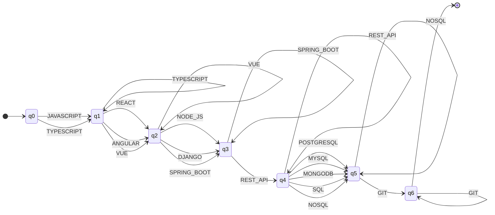
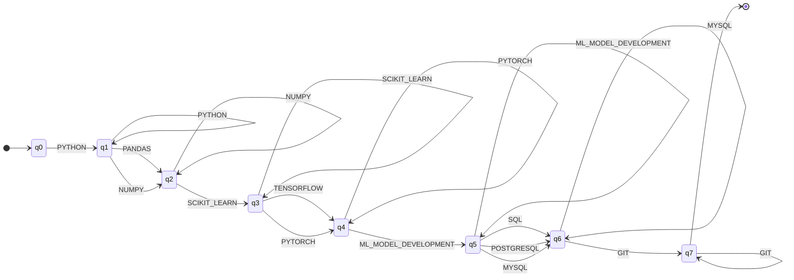
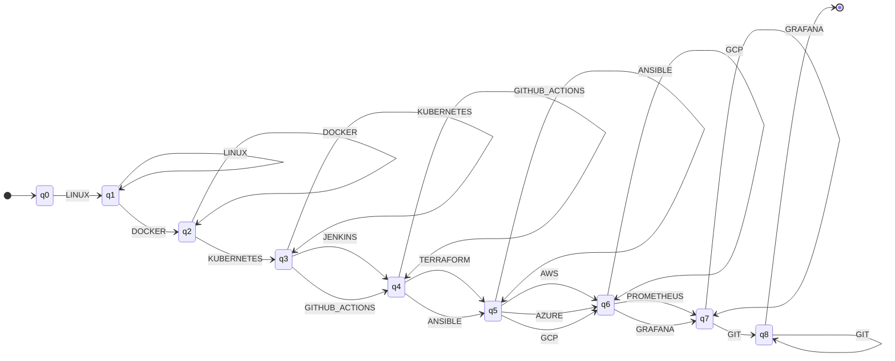
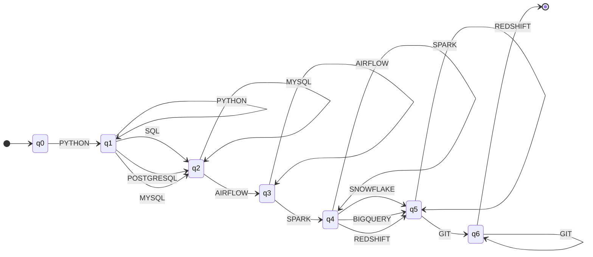

# Stage 3 automata (generated)

Generated by `python -m src.diagrams`.

### Automaton for FULL_STACK_DEVELOPER

Type: DFA (one transition at most per state and token, no epsilon transitions).

- Q = {q0, q1, q2, q3, q4, q5, q6}
- Sigma = {JAVASCRIPT, TYPESCRIPT, REACT, ANGULAR, VUE, NODE_JS, DJANGO, SPRING_BOOT, REST_API, POSTGRESQL, MYSQL, MONGODB, SQL, NOSQL, GIT}
- q0 = q0
- F = {q6}
- delta (partial function, a missing transition means reject):

| from | reads | to |
|------|-------|----|
| q0 | JAVASCRIPT | q1 |
| q1 | JAVASCRIPT | q1 |
| q0 | TYPESCRIPT | q1 |
| q1 | TYPESCRIPT | q1 |
| q1 | REACT | q2 |
| q2 | REACT | q2 |
| q1 | ANGULAR | q2 |
| q2 | ANGULAR | q2 |
| q1 | VUE | q2 |
| q2 | VUE | q2 |
| q2 | NODE_JS | q3 |
| q3 | NODE_JS | q3 |
| q2 | DJANGO | q3 |
| q3 | DJANGO | q3 |
| q2 | SPRING_BOOT | q3 |
| q3 | SPRING_BOOT | q3 |
| q3 | REST_API | q4 |
| q4 | REST_API | q4 |
| q4 | POSTGRESQL | q5 |
| q5 | POSTGRESQL | q5 |
| q4 | MYSQL | q5 |
| q5 | MYSQL | q5 |
| q4 | MONGODB | q5 |
| q5 | MONGODB | q5 |
| q4 | SQL | q5 |
| q5 | SQL | q5 |
| q4 | NOSQL | q5 |
| q5 | NOSQL | q5 |
| q5 | GIT | q6 |
| q6 | GIT | q6 |

Pattern, in order: language (JAVASCRIPT | TYPESCRIPT) -> ui framework (REACT | ANGULAR | VUE) -> backend technology (NODE_JS | DJANGO | SPRING_BOOT) -> api (REST_API) -> database (POSTGRESQL | MYSQL | MONGODB | SQL | NOSQL) -> version control (GIT)

### Automaton for MACHINE_LEARNING_ENGINEER

Type: DFA (one transition at most per state and token, no epsilon transitions).

- Q = {q0, q1, q2, q3, q4, q5, q6, q7}
- Sigma = {PYTHON, PANDAS, NUMPY, SCIKIT_LEARN, TENSORFLOW, PYTORCH, ML_MODEL_DEVELOPMENT, SQL, POSTGRESQL, MYSQL, GIT}
- q0 = q0
- F = {q7}
- delta (partial function, a missing transition means reject):

| from | reads | to |
|------|-------|----|
| q0 | PYTHON | q1 |
| q1 | PYTHON | q1 |
| q1 | PANDAS | q2 |
| q2 | PANDAS | q2 |
| q1 | NUMPY | q2 |
| q2 | NUMPY | q2 |
| q2 | SCIKIT_LEARN | q3 |
| q3 | SCIKIT_LEARN | q3 |
| q3 | TENSORFLOW | q4 |
| q4 | TENSORFLOW | q4 |
| q3 | PYTORCH | q4 |
| q4 | PYTORCH | q4 |
| q4 | ML_MODEL_DEVELOPMENT | q5 |
| q5 | ML_MODEL_DEVELOPMENT | q5 |
| q5 | SQL | q6 |
| q6 | SQL | q6 |
| q5 | POSTGRESQL | q6 |
| q6 | POSTGRESQL | q6 |
| q5 | MYSQL | q6 |
| q6 | MYSQL | q6 |
| q6 | GIT | q7 |
| q7 | GIT | q7 |

Pattern, in order: language (PYTHON) -> data library (PANDAS | NUMPY) -> classic ml library (SCIKIT_LEARN) -> deep learning library (TENSORFLOW | PYTORCH) -> model development (ML_MODEL_DEVELOPMENT) -> database (SQL | POSTGRESQL | MYSQL) -> version control (GIT)

### Automaton for DEVOPS_ENGINEER

Type: DFA (one transition at most per state and token, no epsilon transitions).

- Q = {q0, q1, q2, q3, q4, q5, q6, q7, q8}
- Sigma = {LINUX, DOCKER, KUBERNETES, JENKINS, GITHUB_ACTIONS, TERRAFORM, ANSIBLE, AWS, AZURE, GCP, PROMETHEUS, GRAFANA, GIT}
- q0 = q0
- F = {q8}
- delta (partial function, a missing transition means reject):

| from | reads | to |
|------|-------|----|
| q0 | LINUX | q1 |
| q1 | LINUX | q1 |
| q1 | DOCKER | q2 |
| q2 | DOCKER | q2 |
| q2 | KUBERNETES | q3 |
| q3 | KUBERNETES | q3 |
| q3 | JENKINS | q4 |
| q4 | JENKINS | q4 |
| q3 | GITHUB_ACTIONS | q4 |
| q4 | GITHUB_ACTIONS | q4 |
| q4 | TERRAFORM | q5 |
| q5 | TERRAFORM | q5 |
| q4 | ANSIBLE | q5 |
| q5 | ANSIBLE | q5 |
| q5 | AWS | q6 |
| q6 | AWS | q6 |
| q5 | AZURE | q6 |
| q6 | AZURE | q6 |
| q5 | GCP | q6 |
| q6 | GCP | q6 |
| q6 | PROMETHEUS | q7 |
| q7 | PROMETHEUS | q7 |
| q6 | GRAFANA | q7 |
| q7 | GRAFANA | q7 |
| q7 | GIT | q8 |
| q8 | GIT | q8 |

Pattern, in order: operating system (LINUX) -> container runtime (DOCKER) -> orchestration (KUBERNETES) -> ci/cd (JENKINS | GITHUB_ACTIONS) -> infrastructure as code (TERRAFORM | ANSIBLE) -> cloud provider (AWS | AZURE | GCP) -> monitoring (PROMETHEUS | GRAFANA) -> version control (GIT)

### Automaton for DATA_ENGINEER

Type: DFA (one transition at most per state and token, no epsilon transitions).

- Q = {q0, q1, q2, q3, q4, q5, q6}
- Sigma = {PYTHON, SQL, POSTGRESQL, MYSQL, AIRFLOW, SPARK, SNOWFLAKE, BIGQUERY, REDSHIFT, GIT}
- q0 = q0
- F = {q6}
- delta (partial function, a missing transition means reject):

| from | reads | to |
|------|-------|----|
| q0 | PYTHON | q1 |
| q1 | PYTHON | q1 |
| q1 | SQL | q2 |
| q2 | SQL | q2 |
| q1 | POSTGRESQL | q2 |
| q2 | POSTGRESQL | q2 |
| q1 | MYSQL | q2 |
| q2 | MYSQL | q2 |
| q2 | AIRFLOW | q3 |
| q3 | AIRFLOW | q3 |
| q3 | SPARK | q4 |
| q4 | SPARK | q4 |
| q4 | SNOWFLAKE | q5 |
| q5 | SNOWFLAKE | q5 |
| q4 | BIGQUERY | q5 |
| q5 | BIGQUERY | q5 |
| q4 | REDSHIFT | q5 |
| q5 | REDSHIFT | q5 |
| q5 | GIT | q6 |
| q6 | GIT | q6 |

Pattern, in order: language (PYTHON) -> database (SQL | POSTGRESQL | MYSQL) -> orchestration (AIRFLOW) -> distributed processing (SPARK) -> data warehouse (SNOWFLAKE | BIGQUERY | REDSHIFT) -> version control (GIT)

